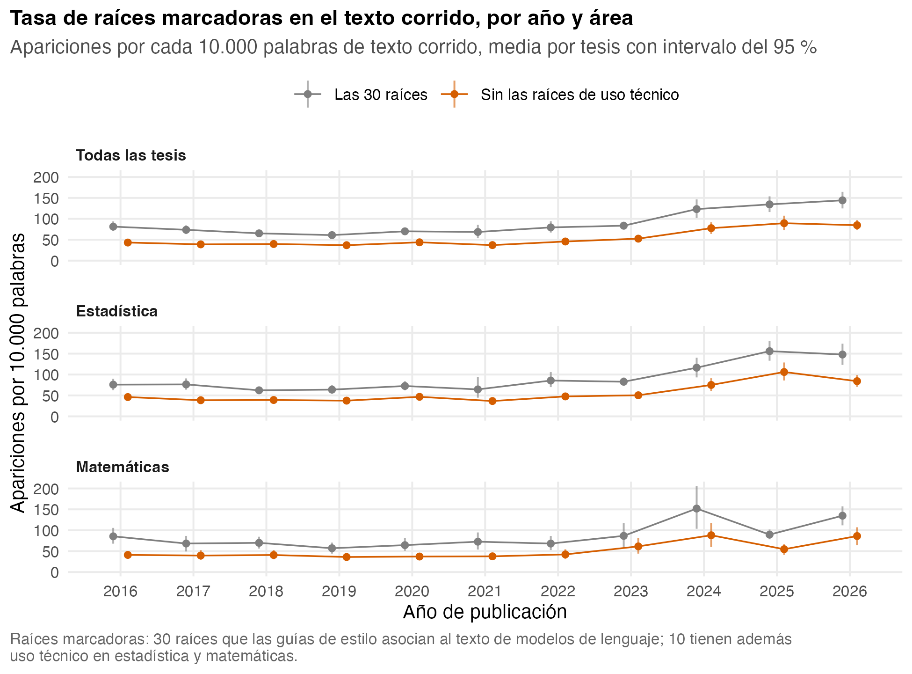

# Temas, forma topológica y vocabulario de las tesis de Estadística y Matemáticas de la UNAL

**EN** — Did master's and doctoral theses in Statistics and Mathematics at Universidad Nacional de Colombia change after generative AI? A Kohonen self-organizing map and a window classifier locate the topic shift, on both a classic TF-IDF/LSA representation and transformer embeddings. Persistent homology measures the shape of the thesis cloud, with permutation tests and a power check. Word counts on full texts track vocabulary, with controls for length, field and new topics. Every before/after comparison is paired with a control between two pre-AI windows.

**ES** — Temas, topología y vocabulario de las tesis de Estadística y Matemáticas de la UNAL antes y después de la IA generativa, con un mapa autoorganizado, representaciones de un transformador, homología persistente y conteo de palabras. Cada comparación tiene un control entre dos ventanas previas.

Artículo: [`topologia.pdf`](topologia.pdf). English version: [`topologia_en.pdf`](topologia_en.pdf). Autor: Daniel Felipe Villa Rengifo.

## Resultado

- **Temas.** Las tesis de 2023-2026 se reparten en el mapa distinto que las de 2018-2021 en 14 de 20 mapas; en el control, en 3. Un perceptrón distingue esas ventanas con AUC 0,70; en el control, 0,49.
- **Forma.** La nube de tesis se contrajo: la distancia media entre dos tesis bajó 2,7 % con TF-IDF y LSA y 1,7 % con las incrustaciones (p de 0,0025 y 0,0005 por permutación), y ninguno de los contrastes del control sobrevive al ajuste por multiplicidad. La homología persistente encuentra además diferencias en los ciclos de la nube; descontada la contracción, esa evidencia es débil.
- **Vocabulario.** En el texto corrido suben 323 palabras entre 2019-2021 y 2023-2026; en el control cambian 0. Con todas las tesis a la misma longitud suben 96.



## Datos

- 910 resúmenes de tesis del [Repositorio Institucional de la Universidad Nacional de Colombia](https://repositorio.unal.edu.co) y texto corrido de 396 tesis desde 2016.
- Este repositorio no incluye los resúmenes ni el texto de las tesis. `make corpus` los baja de la fuente.

## Método

1. Dos representaciones de título y resumen: TF-IDF con análisis semántico latente y vectores de multilingual-E5 (`codigo/corpus.py`).
2. Mapa autoorganizado de 8 × 8, veinte semillas por representación, con contraste por permutación estratificada (`codigo/mapa_tematico.py`).
3. Clasificación de la ventana con perceptrón multicapa, con todo lo que se ajusta dentro del pliegue (`codigo/clasificar_periodo.py`).
4. Escala de la nube y homología persistente de Vietoris-Rips con submuestras de igual tamaño, contraste por permutación estratificada y una prueba con un cambio conocido (`codigo/homologia.py`).
5. Tasa de cada palabra por tesis, prueba de Mann-Whitney, control de falsos descubrimientos y cuatro controles (`codigo/vocabulario.py`).

## Reproducir

```bash
pip install -r requirements.txt
make            # compila el artículo y su versión en inglés
make corpus     # baja las tesis del repositorio de la UNAL (cerca de una hora)
make todo       # rehace todos los análisis y figuras
```

Requiere Python 3.12, R 4.6 con `tidyverse`, `ggwordcloud`, `knitr` y `rmarkdown`, Quarto 1.10, `pdftotext` (poppler) para `make corpus` y la fuente Helvetica Neue. El modelo de lenguaje (multilingual-E5) se baja de Hugging Face la primera vez, cerca de 1 GB.

## Licencia

Código bajo licencia MIT. Texto y figuras del artículo bajo CC BY 4.0. Los metadatos de las tesis pertenecen al Repositorio Institucional de la Universidad Nacional de Colombia y a sus autores.
