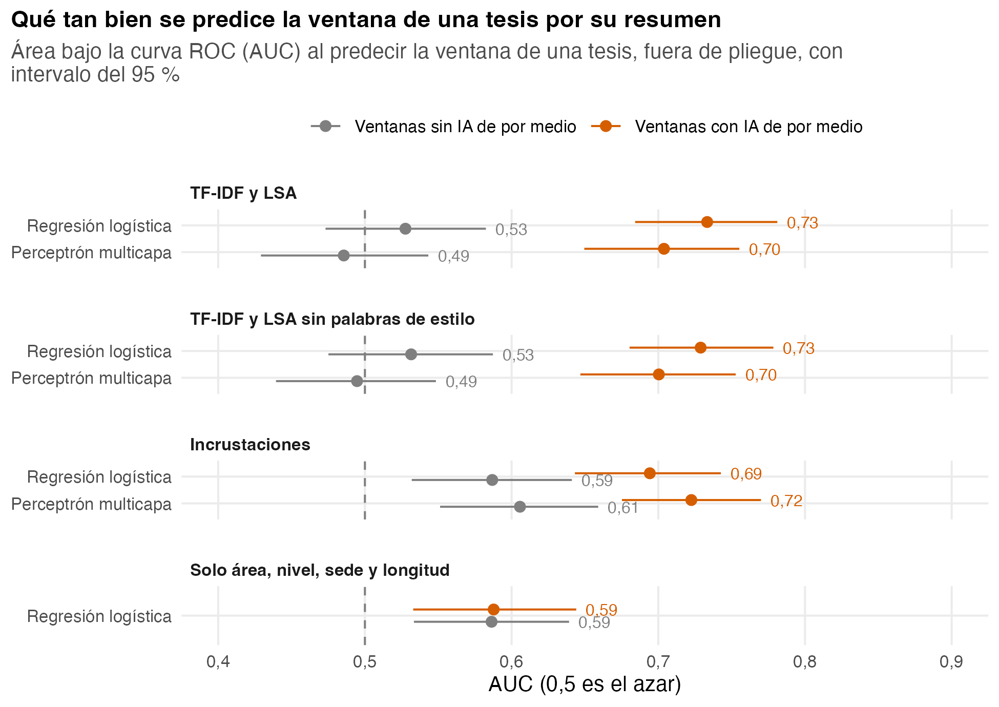
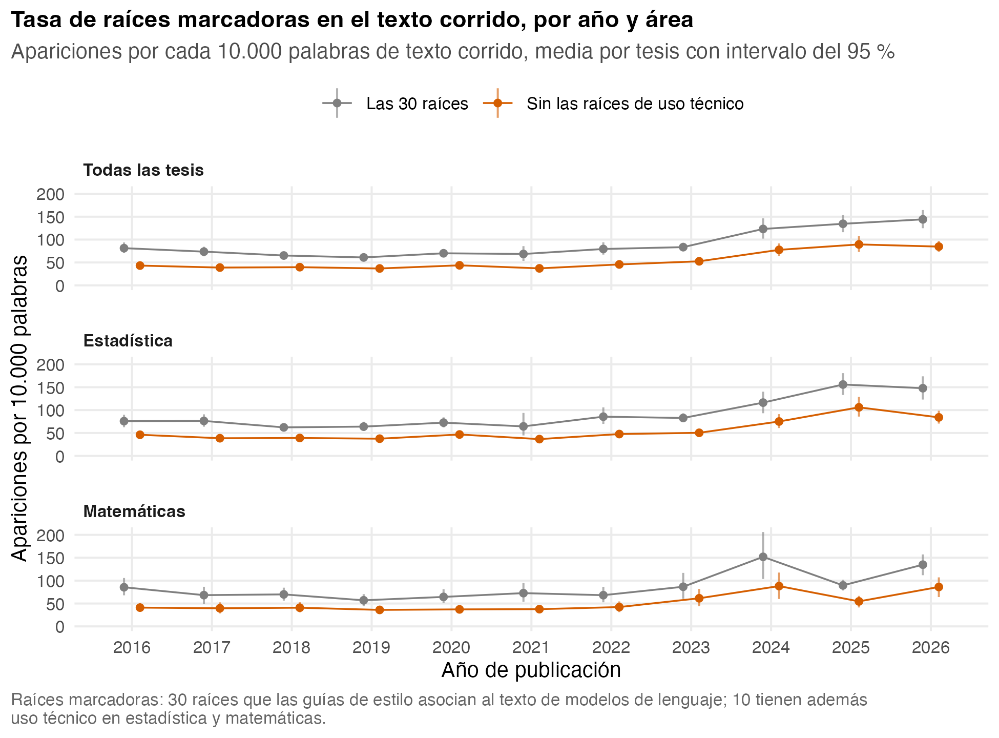
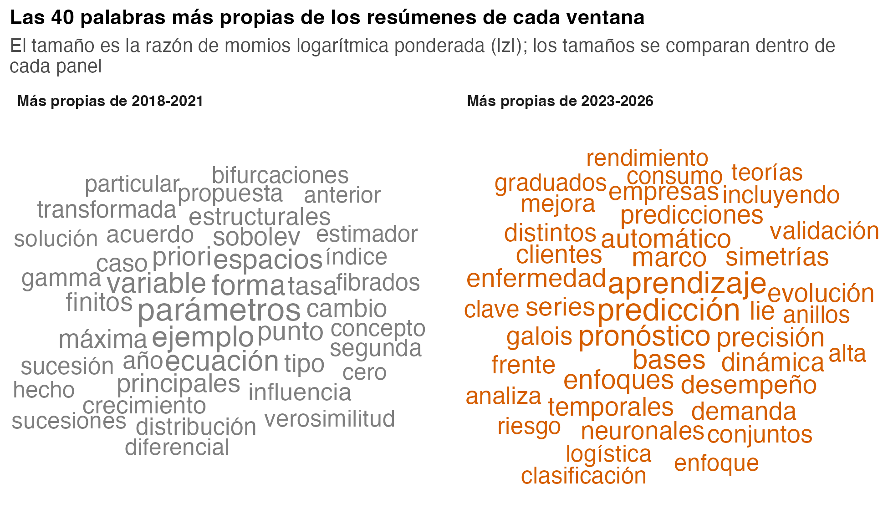

```{=typst}
#set par(justify: true, leading: 0.65em)
#show heading: set text(fill: rgb("#1B365D"), weight: "bold")
#show table.cell: set par(justify: false)
#show table.cell: set text(size: 8pt)
#show figure.caption: set text(size: 8.5pt)
#set figure(placement: auto, scope: "parent")
#set columns(gutter: 0.7cm)
```

```{r}
#| label: preparar
library(dplyr)
library(tidyr)
library(readr)
library(knitr)

leer <- function(archivo) read_csv(file.path("resultados", archivo), show_col_types = FALSE)
# El espacio antes de % es de no separación: el signo no queda solo al cambiar de renglón.
pc <- function(x, d = 0) paste0(formatC(100 * x, format = "f", digits = d, decimal.mark = ","), "\u00a0%")
nm <- function(x, d = 2) formatC(x, format = "f", digits = d, decimal.mark = ",")
ent <- function(x) formatC(as.integer(x), format = "d", big.mark = ".", decimal.mark = ",")
entre <- function(x) paste0("«", x, "»", collapse = ", ")

corpus <- "corpus/datos"
cifras <- with(read_csv(file.path(corpus, "resumen_corpus.csv"), show_col_types = FALSE), setNames(valor, clave))
corpus_por_anio <- read_csv(file.path(corpus, "corpus_por_anio.csv"), show_col_types = FALSE)
ventana <- function(desde, hasta, columna = "tesis") with(corpus_por_anio, sum(get(columna)[anio >= desde & anio <= hasta]))

CON_IA <- "con IA de por medio"
SIN_IA <- "sin IA de por medio"
mapas <- leer("som_contrastes.csv")
estabilidad <- leer("som_estabilidad.csv")
destacadas <- leer("som_destacadas.csv")
temas <- leer("temas_por_ventana.csv")
clasificacion <- leer("clasificacion_periodo.csv")
contrastes <- leer("homologia_contrastes.csv") |> mutate(valor_q = p.adjust(valor_p, method = "BH"))
potencia <- leer("homologia_potencia.csv")
sin_aprendizaje <- leer("homologia_sensibilidad.csv")
compacidad <- leer("homologia_compacidad.csv")
lsa <- with(leer("lsa.csv"), setNames(valor, clave))
vocabulario <- leer("vocabulario_resumen.csv")
cambios <- leer("vocabulario_cambios.csv")
marcadores <- leer("marcadores_por_anio.csv")
raices <- leer("marcadores_raices.csv")

mapa <- function(repr, comp) filter(mapas, representacion == repr, comparacion == comp)
auc <- function(comp, repr = "todas las palabras", clas = "perceptron", columna = "auc") {
  clasificacion |> filter(comparacion == comp, representacion == repr, clasificador == clas) |> pull(all_of(columna))
}
auc_ic <- function(comp, repr = "todas las palabras", clas = "perceptron") {
  paste0(nm(auc(comp, repr, clas)), " (", nm(auc(comp, repr, clas, "auc_inf")), " a ", nm(auc(comp, repr, clas, "auc_sup")), ")")
}
voc <- function(comp, control_elegido = "todas las tesis") filter(vocabulario, comparacion == comp, control == control_elegido)
tasa_media <- function(desde, hasta, serie_elegida = "todas las raíces", area_elegida = "todas") {
  with(filter(marcadores, serie == serie_elegida, area == area_elegida, anio >= desde, anio <= hasta), weighted.mean(tasa, n_tesis))
}
ml <- function(v) with(filter(temas, ventana == v), de_aprendizaje_automatico / tesis)
suben_mas <- cambios |> filter(comparacion == CON_IA) |> slice_max(z, n = 15)
bajan_mas <- cambios |> filter(comparacion == CON_IA) |> slice_min(z, n = 15)
raices_ia <- filter(raices, comparacion == CON_IA)
raices_previas <- filter(raices, comparacion == SIN_IA)
propias <- leer("logodds_resumenes.csv")
mas_propias <- function(v, n = 6) entre(head(arrange(filter(propias, ventana == v), desc(abs(z)))$palabra, n))
# «Ninguna cambia» en vez de «0 cambian».
cuantas_cambian <- function(n) ifelse(n == 0, "ninguna cambia", ifelse(n == 1, "1 cambia", paste(n, "cambian")))
LSA <- "tesis (LSA)"
E5 <- "tesis (incrustaciones)"
ESCALA <- "diferencia de distancia media"
EN_FORMULA <- c(
  "diferencia de distancia media" = "la distancia media", "diferencia de L0" = "$L_0$", "diferencia de L1" = "$L_1$",
  "W0" = "$W_0$", "W1" = "$W_1$", "W0 a escala" = "$W_0$ a escala", "W1 a escala" = "$W_1$ a escala"
)
EN_TABLA <- c(
  "diferencia de distancia media" = "Distancia media (diferencia)", "diferencia de L0" = "L0, componentes (diferencia)",
  "diferencia de L1" = "L1, ciclos (diferencia)", "W0" = "W0, componentes", "W1" = "W1, ciclos",
  "W0 a escala" = "W0 a escala", "W1 a escala" = "W1 a escala"
)
p_de <- function(nube_elegida, comp, estadistico_elegido, columna = "valor_p", tabla = contrastes) {
  filter(tabla, nube == nube_elegida, comparacion == comp, estadistico == estadistico_elegido)[[columna]]
}
# Cambio relativo de la distancia media entre dos tesis de una ventana a la siguiente.
contraccion <- function(nube_elegida, comp = CON_IA, tabla = contrastes) {
  fila <- filter(tabla, nube == nube_elegida, comparacion == comp, estadistico == ESCALA)
  fila$observado / fila$nivel_de_la_primera
}
SIN_APRENDIZAJE <- unique(sin_aprendizaje$comparacion)
sobreviven <- filter(contrastes, valor_q < 0.05)
que_sobreviven <- function(nube_elegida) combine_words(EN_FORMULA[filter(sobreviven, nube == nube_elegida)$estadistico], and = " y ", oxford_comma = FALSE)
rechazos <- function(fraccion, estadistico_elegido) filter(potencia, fraccion_plantada == fraccion, estadistico == estadistico_elegido)$rechazos

# Lo que el texto afirma de la forma de la nube. Si los datos cambian, esto falla y hay que reescribir esos párrafos.
stopifnot(
  length(SIN_APRENDIZAJE) == 1, nrow(potencia) > 0,
  # Lo que sobrevive al ajuste es con IA de por medio y en las nubes de tesis.
  all(sobreviven$comparacion == CON_IA), all(sobreviven$nube != "palabras"),
  # La contracción y la diferencia de ciclos sobreviven con las dos representaciones.
  all(c(p_de(LSA, CON_IA, ESCALA, "valor_q"), p_de(E5, CON_IA, ESCALA, "valor_q")) < 0.05),
  all(c(p_de(LSA, CON_IA, "W1", "valor_q"), p_de(E5, CON_IA, "W1", "valor_q")) < 0.05),
  contraccion(LSA) < 0, contraccion(E5) < 0,
  # Descontada la escala, la diferencia de ciclos no sobrevive con LSA y el control con incrustaciones da un p parecido.
  p_de(LSA, CON_IA, "W1 a escala", "valor_q") >= 0.05, p_de(E5, SIN_IA, "W1 a escala") < 0.05,
  # L1 baja con las incrustaciones.
  p_de(E5, CON_IA, "diferencia de L1", "observado") < 0, p_de(E5, CON_IA, "diferencia de L1", "valor_q") < 0.05,
  # Las tesis de aprendizaje automático están más juntas que un conjunto al azar, y sin ellas la contracción sigue.
  all(compacidad$valor_p < 0.05), all(compacidad$distancia_media < compacidad$distancia_media_al_azar),
  all(filter(sin_aprendizaje, estadistico == ESCALA)$valor_p < 0.05),
  abs(contraccion(LSA, SIN_APRENDIZAJE, sin_aprendizaje)) < abs(contraccion(LSA)),
  p_de(LSA, SIN_APRENDIZAJE, "W1", tabla = sin_aprendizaje) < 0.05, p_de(E5, SIN_APRENDIZAJE, "W1", tabla = sin_aprendizaje) >= 0.05,
  # Sin cambio plantado la prueba casi no rechaza.
  max(filter(potencia, fraccion_plantada == 0)$rechazos) <= 3,
  # Quitar las palabras de estilo no baja el AUC del clasificador.
  auc(CON_IA, "sin palabras de estilo") > auc(CON_IA) - 0.02,
  # El control del mapa no es nulo en todos los mapas, y el del vocabulario sí.
  sum(mapa("LSA", SIN_IA)$valor_p < 0.05) > 0, all(with(filter(vocabulario, comparacion == SIN_IA), suben + bajan) == 0)
)
```

```{=typst}
#place(top + center, scope: "parent", float: true)[
#set align(left)
```

**Programa:** `r rmarkdown::metadata$programa`. **Profesor:** `r rmarkdown::metadata$profesor`. **Curso:** `r rmarkdown::metadata$materia`.

```{=typst}
#block(fill: rgb("#F2F5F9"), inset: 11pt, radius: 3pt, width: 100%)[
```

**Resumen.** Se estudia si las tesis de maestría y doctorado en Estadística y Matemáticas de la Universidad Nacional de Colombia cambiaron de temas, de forma y de vocabulario desde 2023. El corpus son `r ent(cifras["tesis_de_analisis"])` resúmenes y, de `r ent(cifras["tesis_con_texto_corrido"])` tesis, también el texto corrido (la prosa del PDF, sin tablas ni fórmulas). Se comparan ventanas de años: 2018-2021 frente a 2023-2026, con la inteligencia artificial (IA) generativa de por medio, y como control dos ventanas anteriores entre sí. En mapas autoorganizados entrenados con 20 semillas, las tesis de 2023-2026 se reparten distinto que las de 2018-2021 en `r sum(mapa("LSA", CON_IA)$valor_p < 0.05)` mapas con una representación del texto y en `r sum(mapa("incrustaciones", CON_IA)$valor_p < 0.05)` con la otra; en el control, en `r sum(mapa("LSA", SIN_IA)$valor_p < 0.05)` y en `r sum(mapa("incrustaciones", SIN_IA)$valor_p < 0.05)`. Un perceptrón multicapa distingue esas dos ventanas con un área bajo la curva ROC (AUC) de `r nm(auc(CON_IA))`; en el control el AUC es `r nm(auc(SIN_IA))` (0,5 es el azar). Las tesis de aprendizaje automático pasan de `r pc(ml("2018-2021"))` a `r pc(ml("2023-2026"))` del total. Vistas como una nube de puntos, las tesis recientes se parecen más entre sí: la distancia media entre dos tesis bajó `r pc(-contraccion(LSA), 1)` con una representación y `r pc(-contraccion(E5), 1)` con la otra, más de lo que da barajar las tesis entre ventanas (p de `r nm(p_de(LSA, CON_IA, ESCALA), 4)` y `r nm(p_de(E5, CON_IA, ESCALA), 4)`). La homología persistente encuentra además que los ciclos de esa nube (cadenas cerradas de tesis parecidas) difieren entre las dos ventanas; descontada la contracción, esa evidencia es débil. En el control ningún contraste de forma sobrevive al ajuste por multiplicidad. En el texto corrido, `r voc(CON_IA)$suben` de `r ent(voc(CON_IA)$palabras_probadas)` palabras suben de frecuencia entre 2019-2021 y 2023-2026 y en el control `r cuantas_cambian(voc(SIN_IA)$suben + voc(SIN_IA)$bajan)`; con todas las tesis reducidas a la misma longitud suben `r voc(CON_IA, "longitud fija")$suben`. Todas las comparaciones son temporales: no aíslan el efecto de la IA.

```{=typst}
]
```

**Palabras clave:** mapa autoorganizado, perceptrón multicapa, homología persistente, análisis topológico de datos, transformadores, minería de texto, IA generativa.

```{=typst}
#v(0.6em)
]
```

# Introducción

Un corpus de tesis puede cambiar de tres maneras: en sus **temas** (los estudiantes dejan unos y pasan a otros), en su **forma** (las tesis se aprietan en grupos, se dispersan o forman cadenas cerradas: un tema se parece a otro, ese a un tercero y el tercero de nuevo al primero) y en su **vocabulario** (se escribe sobre lo mismo con otras palabras). Una sola medida las confunde.

Del vocabulario hay evidencia en la literatura científica en inglés: desde 2023 creció de forma abrupta la frecuencia de ciertas palabras de estilo (genéricas, que no nombran un tema), y con ese exceso se estimó cuánta escritura pasó por un modelo de lenguaje [@kobak2025delving; @liang2025quantifying; @gray2024contamination]. De los temas y de la forma hay poca evidencia, y casi ninguna sobre tesis en español.

Este trabajo pregunta si, desde 2023, cambiaron los temas, la forma o el vocabulario de las tesis de Estadística y Matemáticas de la Universidad Nacional de Colombia, y usa una herramienta para cada cambio. Los temas se miran con un mapa autoorganizado [@kohonen1982self], la red competitiva vista en el curso, y con un clasificador que predice a qué ventana (grupo de años consecutivos) pertenece una tesis por su contenido. La forma se mide con la distancia media entre tesis y con homología persistente [@edelsbrunner2002topological; @carlsson2009topology], que resume una nube de puntos por los grupos y los ciclos que aparecen al conectarla a distintas distancias. El vocabulario se cuenta en el texto corrido de las tesis.

Un cambio entre 2018-2021 y 2023-2026 no basta para atribuirlo a la IA: los temas de un posgrado se mueven siempre. Por eso cada comparación «con IA de por medio» tiene un control entre dos ventanas anteriores, «sin IA de por medio». Solo se considera hallazgo lo que supera al control.

# Estado del arte

| Línea de trabajo | Idea | Trabajos | En este artículo |
|:----|:--------|:------|:------|
| Temas con matrices de palabras | Cada documento es un vector de frecuencias que se reduce o se descompone en temas | @deerwester1990indexing; @blei2003latent; @hall2008studying | TF-IDF con análisis semántico latente, como primera representación |
| Temas con representaciones de un transformador | Un modelo preentrenado da el vector de cada documento y luego se agrupa | @grootendorst2022bertopic; @angelov2020top2vec; @egger2022topic | Vectores de multilingual-E5 como segunda representación |
| Mapas autoorganizados de ciencia | Una rejilla de unidades ordena los documentos por parecido | @kohonen2000self; @polanco2001using; @skupin2013visualizing | Mapa de 8 × 8 sobre las dos representaciones |
| Topología de datos en texto | Homología persistente sobre representaciones de texto o redes de conceptos | @zhu2013persistent; @wagner2012computational; @salnikov2018cooccurrence; @tulchinskii2023intrinsic | Escala y homología de la nube de tesis y de palabras, con contraste por permutación |
| Exceso de vocabulario | Palabras cuya frecuencia sube desde 2023 | @kobak2025delving; @liang2025quantifying | Tasa por tesis en el texto corrido, con control y comprobaciones |

: Líneas de trabajo y lo que se usa en este artículo. {#tbl-familias}

La @tbl-familias resume las líneas de trabajo de las que sale cada herramienta. El mapa autoorganizado se usó para ordenar millones de documentos [@kohonen2000self; @skupin2013visualizing]; hoy el modelado de temas se hace sobre todo con incrustaciones de transformadores, la arquitectura de red neuronal de los modelos de lenguaje actuales [@grootendorst2022bertopic; @egger2022topic]. Aquí se combinan: el mapa del curso se entrena sobre la representación clásica y sobre la de un transformador [@vaswani2017attention; @wang2024multilingual], y se reporta si el resultado depende de cuál se use. La homología persistente sobre texto es una línea más reciente y menos asentada [@zhu2013persistent; @salnikov2018cooccurrence]; por eso este trabajo prueba también qué clase de cambio ve cada estadístico.

# Datos

El corpus es el del artículo sobre detección que acompaña a este: `r ent(cifras["tesis_de_analisis"])` tesis de maestría y doctorado en Estadística y Matemáticas del Repositorio Institucional de la Universidad Nacional de Colombia. Quedan fuera las de la Maestría en Enseñanza de las Ciencias. De cada resumen en español se quitaron las partes en inglés, las órdenes de LaTeX y la nota «(Texto tomado de la fuente)» que el repositorio añade desde 2021. El área de cada tesis sale del programa o del título otorgado y, si faltan, del departamento.

De las tesis de 2016 en adelante que no están en inglés se descargó además el PDF y se extrajo el texto corrido. Son los bloques de 40 palabras o más en los que al menos 85 % de los elementos son palabras sin cifras ni símbolos y al menos 30 % son palabras de función (artículos, preposiciones, conjunciones). El filtro deja fuera índices, tablas, fórmulas y bibliografía. Entran las tesis con 2.000 palabras o más de texto corrido: `r ent(cifras["tesis_con_texto_corrido"])`, con una mediana de `r ent(cifras["mediana_palabras_texto_corrido"])` palabras. Hay texto corrido de `r pc(ventana(2016, 2026, "con_texto_corrido") / ventana(2016, 2026))` de las tesis de 2016 a 2026. Las escritas en inglés no lo tienen: son `r filter(temas, ventana == "2014-2017")$en_ingles`, `r filter(temas, ventana == "2018-2021")$en_ingles` y `r filter(temas, ventana == "2023-2026")$en_ingles` en las tres ventanas que se definen a continuación.

Los resúmenes se comparan en tres ventanas de cuatro años: 2014-2017 (`r ventana(2014, 2017)` tesis), 2018-2021 (`r ventana(2018, 2021)`) y 2023-2026 (`r ventana(2023, 2026)`). El año 2022 queda fuera porque los modelos de lenguaje de uso masivo salieron a finales de ese año y no se puede saber qué tesis los alcanzaron; 2026 está incompleto. El texto corrido existe desde 2016, así que sus dos ventanas anteriores son de tres años (2016-2018 y 2019-2021); la reciente es la misma, 2023-2026.

Una tesis se cuenta como de aprendizaje automático si su título o su resumen nombran, entre otros, «aprendizaje automático», «redes neuronales», «bosques aleatorios» o «inteligencia artificial»; la lista completa está en el código.

# Método

## Representaciones de las tesis

Cada tesis es su título seguido de su resumen. Se usan dos representaciones, es decir, dos maneras de convertir ese texto en un vector.

**TF-IDF y LSA.** Se calcula el peso TF-IDF (la frecuencia de un término en la tesis, rebajada si el término aparece en muchas tesis) de las palabras y pares de palabras que aparecen en al menos cinco tesis y en no más de la mitad, sin palabras vacías (artículos, preposiciones). La matriz se reduce a 50 dimensiones con análisis semántico latente (LSA) [@deerwester1990indexing]. Esas dimensiones retienen `r pc(lsa["varianza_retenida_lsa"])` de la varianza. Cada vector se lleva a norma uno, de modo que la distancia euclídea entre dos tesis es función del coseno entre ellas.

**Incrustaciones.** Una incrustación es el vector que un modelo preentrenado asigna a un texto, de modo que textos de contenido parecido quedan cerca. El texto pasa por multilingual-E5 [@wang2024multilingual], un codificador transformador, y se promedian los vectores de sus fichas (los trozos de palabra en que el modelo parte el texto). El vector de 768 dimensiones se reduce a 50 por componentes principales y se lleva a norma uno.

## Mapa autoorganizado

El mapa es una rejilla de $8 \times 8$ unidades, cada una con un vector de pesos $w_j$ en el espacio de las tesis. Se entrena tesis por tesis con la regla de Kohonen [@kohonen1982self; @kohonen2001self]. Para cada tesis $x$ gana la unidad más cercana, $c = \arg\min_j \lVert x - w_j \rVert$, y ella y sus vecinas se acercan al dato:

$$
w_j \leftarrow w_j + \alpha(t)\, e^{-d(j, c)^2 / 2 r(t)^2}\, (x - w_j),
$$ {#eq-kohonen}

donde $d(j, c)$ es la distancia entre las dos unidades en la rejilla. La tasa $\alpha$ baja de 0,5 a 0,01 y el radio $r$ de 4 a 0,5, los dos de forma geométrica, en 30 pasadas por el corpus. La calidad se mide con dos errores [@kiviluoto1996topology]. El de cuantización es la distancia media de cada tesis a su unidad ganadora; entre vectores de norma uno el máximo es 2. El topográfico es la proporción de tesis cuyas dos unidades más cercanas no son contiguas, contando como contiguas las ocho que rodean a una unidad.

Un mapa depende del orden de los datos y de los pesos iniciales. Se entrenan 20 mapas con semillas distintas por representación y se mide cuánto coinciden con el índice de Rand ajustado entre las asignaciones de cada par de mapas: vale 1 si dos mapas agrupan las tesis igual y cerca de 0 si coinciden como al azar.

**Contraste.** Se cuenta cuántas tesis de cada ventana caen en cada unidad. Si las tesis de una ventana se repartieran en el mapa como las de la anterior, esa tabla de unidades por ventanas sería homogénea. El estadístico es su ji cuadrado. La distribución nula se obtiene barajando 2.000 veces la ventana de las tesis dentro de cada área y sede de la universidad, para que un cambio en la mezcla de áreas o de sedes no se tome por un cambio de temas. El contraste se hace en las dos comparaciones y en los 20 mapas.

## Clasificación de la ventana

Otra forma de medir un cambio de temas es preguntar si se puede predecir de qué ventana es una tesis por su representación. Se entrenan un perceptrón multicapa (una capa oculta de 8 o 16 neuronas, con el tamaño y la penalización elegidos por validación interna) y una regresión logística, con validación cruzada de cinco pliegues repetida tres veces. El TF-IDF y el LSA se ajustan dentro de cada pliegue, solo con las tesis de entrenamiento. Se reporta el AUC de la probabilidad fuera de pliegue, promediada en las tres repeticiones: la probabilidad de que el clasificador dé mayor puntaje a una tesis de la ventana reciente que a una de la anterior, donde 0,5 es el azar. El intervalo sale de remuestrear tesis y no incluye la variación de volver a entrenar. Los pliegues no se agrupan por autor; un autor con dos tesis en ventanas distintas no ayuda a separarlas.

Se comparan cuatro entradas. La primera es TF-IDF con LSA. La segunda es la misma después de quitar del texto las palabras de estilo, para separar tema de redacción: 30 conectores (como «por lo tanto») y las raíces marcadoras sin uso técnico, que se definen en la sección de vocabulario. La tercera son las incrustaciones. La cuarta es una referencia de composición: solo el área, el nivel, la sede y la longitud del resumen. Dice cuánto se predice sin leer el contenido.

## Forma de la nube y homología persistente

Cada tesis es un punto y el conjunto es una nube; dos tesis están cerca si su contenido se parece. La medida más simple de la forma de esa nube es su escala: la distancia media entre dos tesis. Baja cuando las tesis se parecen más entre sí.

La homología persistente describe lo que la escala no ve. La idea es inflar una bola del mismo radio alrededor de cada punto. Con radio pequeño todos los puntos están aislados. Al crecer el radio, los puntos cuyas bolas se tocan se unen en grupos, y los grupos se funden hasta quedar uno solo. A veces los puntos unidos forman un anillo con un hueco en el centro: la tesis A se parece a la B, la B a la C y así hasta volver a la A, sin tesis en medio. El anillo desaparece cuando el radio alcanza para cerrar el hueco. Cada grupo y cada anillo nace a un radio y muere a otro, y la diferencia es su persistencia: los que duran poco se suelen leer como ruido y los que duran, como estructura de la nube [@edelsbrunner2002topological; @zomorodian2005computing].

En términos formales, los grupos son componentes conexas (dimensión 0) y los anillos son ciclos (dimensión 1). Dado un radio $\varepsilon$, el complejo de Vietoris-Rips une con una arista los puntos a distancia menor o igual que $\varepsilon$ y rellena cada triángulo cuyas tres aristas ya existen. Cada componente y cada ciclo deja un intervalo $[b_i, d_i)$: nace en el radio $b_i$ y muere en el $d_i$. Los intervalos de una dimensión forman su diagrama de persistencia: hay un diagrama de componentes y un diagrama de ciclos.

Cada diagrama se resume en su persistencia total,

$$
L_k = \sum_{i} (d_i - b_i), \qquad k = 0, 1,
$$ {#eq-persistencia}

sin contar la componente que nunca muere. $L_0$ es la longitud de la red más corta que conecta todos los puntos (el árbol generador mínimo): mide la distancia entre tesis vecinas, y baja cuando cada tesis tiene otra muy parecida. $L_1$ suma la duración de los ciclos. Dos diagramas distintos pueden tener la misma persistencia total. Por eso se usa además la distancia de Wasserstein de orden 1 entre los diagramas de dos ventanas: empareja los intervalos de un diagrama con los del otro y suma cuánto hay que mover nacimientos y muertes para que coincidan; vale cero si los diagramas son iguales. $W_0$ es la distancia entre los diagramas de componentes y $W_1$ entre los de ciclos. Si una nube se contrae, sus diagramas se encogen aunque su forma sea la misma. Para separar las dos cosas, $W_0$ y $W_1$ se calculan también «a escala», después de dividir cada nube por su distancia media.

Se estudian tres nubes por ventana: las tesis con su vector LSA, las tesis con su incrustación, y las palabras, donde cada punto es uno de los 200 términos más frecuentes descrito por su peso TF-IDF en cada tesis de la submuestra y reducido a 30 dimensiones. Zhu [-@zhu2013persistent] y Wagner, Dłotko y Mrozek [-@wagner2012computational] propusieron construcciones de este tipo para texto.

La persistencia total crece con el número de puntos, así que todas las nubes se construyen con submuestras de 150 tesis. Para comparar dos ventanas, cada estadístico es la media en diez pares de submuestras, una de cada ventana. Su distribución nula se obtiene barajando 2.000 veces la ventana de las tesis dentro de cada área y sede y repitiendo el mismo cálculo; el esquema de permutación es el de Robinson y Turner [-@robinson2017hypothesis], con otros estadísticos. Son siete estadísticos (las diferencias de distancia media, de $L_0$ y de $L_1$, y las distancias $W_0$ y $W_1$, tal cual y a escala), tres nubes y dos comparaciones: `r nrow(contrastes)` contrastes. En las diferencias el contraste es de dos colas y en las distancias, de una. Los diagramas se calculan con Ripser [@bauer2021ripser; @tralie2018ripser]. Los valores p se ajustan por el método de Benjamini y Hochberg [-@benjamini1995controlling]; el valor ajustado se llama q.

**Dos comprobaciones.** El contraste con IA de por medio se repite sin las tesis de aprendizaje automático, para ver cuánto del cambio de forma se debe a ese tema. Aparte se mide si esas tesis están más juntas que un conjunto al azar de tesis de su ventana y del mismo tamaño, con 5.000 sorteos.

**Prueba con un cambio conocido.** Para saber qué clase de cambio ve cada estadístico, la ventana 2018-2021 se parte al azar en dos mitades, entre las que no hay diferencia real. En una se reemplaza el 10 %, el 20 % o el 30 % de las tesis por tesis de aprendizaje automático de 2023-2026, y después se contrastan las dos mitades. Se repite con `r unique(potencia$replicas)` particiones por fracción, con la nube LSA, `r unique(potencia$tesis_por_nube)` tesis por nube, cinco pares de submuestras y 99 permutaciones, y se cuenta en cuántas particiones se rechaza al 5 %.

## Vocabulario

Para cada tesis con texto corrido se calcula la tasa de cada palabra por 10.000 palabras. Para cada palabra se comparan las tasas de las tesis de una ventana con las de la otra mediante la prueba de Mann y Whitney [-@mann1947test], que no supone normalidad. Se prueban las palabras presentes en al menos 20 % de las tesis de las tres ventanas juntas, de modo que las dos comparaciones usan el mismo conjunto de palabras. Se cuentan las palabras con valor q de Benjamini y Hochberg [-@benjamini1995controlling] menor que 0,05. La unidad es la tesis y no la palabra: una tesis larga que repite un término cuenta una vez.

Un cambio de vocabulario puede venir de otra parte: tesis más largas, otra mezcla de áreas o temas nuevos. El conteo se repite con cuatro comprobaciones: con cada tesis reducida al azar a 4.000 palabras, lo que deja fuera las que tienen menos; solo con Estadística; solo con Matemáticas; y sin las tesis de aprendizaje automático.

Aparte se sigue año por año la tasa conjunta de `r nrow(raices_ia)` raíces marcadoras, las mismas del artículo sobre detección. La lista se tomó de guías de estilo en español sobre texto de modelos de lenguaje, no de estos datos, y no tiene una fuente académica. De ellas, `r sum(raices_ia$con_uso_tecnico)` tienen además uso técnico («robusto», «integral», «proporción»), así que la serie se reporta con y sin ellas. Para los resúmenes se calcula la razón de momios logarítmica de Monroe, Colaresi y Quinn [-@monroe2008fightin], que dice qué palabras son más propias de una ventana que de otra y da menos peso a las palabras raras.

# Resultados

## Los temas en el mapa

```{r}
#| label: tbl-mapas
#| tbl-cap: "Contraste por permutación del reparto de las tesis en el mapa autoorganizado, en 20 mapas por representación. p: valor p del ji cuadrado con 2.000 permutaciones."
mapas |>
  group_by(Representación = if_else(representacion == "LSA", "TF-IDF y LSA", "Incrustaciones"),
           Comparación = if_else(comparacion == SIN_IA, "Control (2014-2017 frente a 2018-2021)", "2018-2021 frente a 2023-2026")) |>
  summarise(`Mapas con p < 0,05` = paste0(sum(valor_p < 0.05), " de ", n()), `p mediano` = nm(median(valor_p), 3),
            `p mínimo y máximo` = paste0(nm(min(valor_p), 4), " a ", nm(max(valor_p), 3)), .groups = "drop") |>
  arrange(desc(Representación), desc(Comparación)) |>
  kable()
```

Con la representación LSA, las tesis de 2023-2026 se reparten distinto que las de 2018-2021 en `r sum(mapa("LSA", CON_IA)$valor_p < 0.05)` de los 20 mapas, con un valor p mediano de `r nm(median(mapa("LSA", CON_IA)$valor_p), 3)` (@tbl-mapas). En el control, 2014-2017 frente a 2018-2021, el contraste rechaza en `r sum(mapa("LSA", SIN_IA)$valor_p < 0.05)` mapas, con p mediano de `r nm(median(mapa("LSA", SIN_IA)$valor_p), 3)`. Con las incrustaciones rechaza en `r sum(mapa("incrustaciones", CON_IA)$valor_p < 0.05)` mapas con IA de por medio y en `r sum(mapa("incrustaciones", SIN_IA)$valor_p < 0.05)` en el control: el resultado es más débil con esa representación. El error de cuantización medio es `r nm(mean(mapa("LSA", CON_IA)$error_cuantizacion), 2)` con LSA y `r nm(mean(mapa("incrustaciones", CON_IA)$error_cuantizacion), 2)` con las incrustaciones, y el topográfico, `r pc(mean(mapa("LSA", CON_IA)$error_topografico), 1)` y `r pc(mean(mapa("incrustaciones", CON_IA)$error_topografico), 1)`.

Los mapas de distintas semillas no son iguales: el índice de Rand ajustado medio entre pares es `r nm(filter(estabilidad, representacion == "LSA")$rand_ajustado_medio)` con LSA y `r nm(filter(estabilidad, representacion == "incrustaciones")$rand_ajustado_medio)` con las incrustaciones. Un tema no cae en la misma unidad de un mapa a otro, y por eso la conclusión se apoya en el contraste repetido y no en la lectura de un mapa.

{#fig-mapa width=58%}

```{r}
#| label: tbl-unidades
#| tbl-cap: "Unidades del mapa de la figura con más y con menos tesis de 2023-2026 de las esperadas frente a 2018-2021. Las columnas de años dan el número de tesis. Residuo de Pearson frente a un reparto homogéneo: positivo es exceso y negativo, defecto. Es una ilustración: en otro mapa las unidades son otras."
destacadas |>
  transmute(Unidad = letra, Sentido = if_else(residuo > 0, "Crece", "Baja"), `Términos con más peso` = terminos,
            `2014-2017` = `2014-2017`, `2018-2021` = `2018-2021`, `2023-2026` = `2023-2026`, Residuo = nm(residuo, 1)) |>
  kable()
```

La @fig-mapa y la @tbl-unidades ilustran dónde ocurre el cambio en uno de los mapas. La unidad con mayor exceso de tesis recientes (A) reúne los términos «`r filter(destacadas, letra == "A")$terminos`». Como en otro mapa las unidades son otras, se usa una medida que no depende del mapa: las tesis de aprendizaje automático. Son `r filter(temas, ventana == "2014-2017")$de_aprendizaje_automatico` de `r filter(temas, ventana == "2014-2017")$tesis` en 2014-2017 (`r pc(ml("2014-2017"))`), `r filter(temas, ventana == "2018-2021")$de_aprendizaje_automatico` de `r filter(temas, ventana == "2018-2021")$tesis` en 2018-2021 (`r pc(ml("2018-2021"))`) y `r filter(temas, ventana == "2023-2026")$de_aprendizaje_automatico` de `r filter(temas, ventana == "2023-2026")$tesis` en 2023-2026 (`r pc(ml("2023-2026"))`).

## Clasificación de la ventana

{#fig-clasificacion width=74%}

Con TF-IDF y LSA ajustados dentro del pliegue, el perceptrón distingue 2023-2026 de 2018-2021 con un AUC de `r auc_ic(CON_IA)`; en el control el AUC es `r auc_ic(SIN_IA)` (@fig-clasificacion). La diferencia entre las dos comparaciones es `r nm(auc("diferencia"))` (intervalo del 95 %: `r nm(auc("diferencia", columna = "auc_inf"))` a `r nm(auc("diferencia", columna = "auc_sup"))`). Con la regresión logística los AUC son `r nm(auc(CON_IA, clas = "logistica"))` y `r nm(auc(SIN_IA, clas = "logistica"))`.

Sin las palabras de estilo, el AUC del perceptrón con IA de por medio es `r nm(auc(CON_IA, "sin palabras de estilo"))`, frente a `r nm(auc(CON_IA))` con todas: quitar el estilo no lo baja, así que en los resúmenes lo que distingue a las tesis recientes es el tema. Con las incrustaciones es `r nm(auc(CON_IA, "incrustaciones"))`, y `r nm(auc(SIN_IA, "incrustaciones"))` en el control. La referencia de composición, que no lee el contenido, llega a `r nm(auc(CON_IA, "composición", "logistica"))` con IA de por medio y a `r nm(auc(SIN_IA, "composición", "logistica"))` en el control. Parte de lo que distingue a dos ventanas es que cambian el área, la sede y la longitud de los resúmenes, y eso pasa en las dos comparaciones.

## La forma de la nube de tesis

{#fig-homologia width=88%}

```{r}
#| label: tbl-forma
#| tbl-cap: "Contrastes de forma en la nube de tesis, con las dos representaciones (LSA e incrustaciones, E5): valor p por permutación y, entre paréntesis, valor q tras el ajuste por multiplicidad. «Con IA»: 2018-2021 frente a 2023-2026. «Control»: 2014-2017 frente a 2018-2021."
contrastes |>
  filter(nube != "palabras") |>
  transmute(Estadístico = factor(EN_TABLA[estadistico], levels = EN_TABLA),
            columna = paste0(if_else(nube == LSA, "LSA", "E5"), ", ", if_else(comparacion == CON_IA, "con IA", "control")),
            celda = paste0(nm(valor_p, 4), " (", nm(valor_q, 3), ")")) |>
  pivot_wider(names_from = columna, values_from = celda) |>
  arrange(Estadístico) |>
  select(Estadístico, `LSA, con IA`, `LSA, control`, `E5, con IA`, `E5, control`) |>
  kable()
```

La nube de tesis se contrajo (@fig-homologia y @tbl-forma). Entre 2018-2021 y 2023-2026 la distancia media entre dos tesis bajó `r pc(-contraccion(LSA), 1)` con LSA y `r pc(-contraccion(E5), 1)` con las incrustaciones, y las dos caídas conservan un q menor que 0,05. En el control la distancia media cambia `r pc(contraccion(LSA, SIN_IA), 1)` con LSA (p de `r nm(p_de(LSA, SIN_IA, ESCALA), 3)`, q de `r nm(p_de(LSA, SIN_IA, ESCALA, "valor_q"), 3)`) y `r pc(contraccion(E5, SIN_IA), 1)` con las incrustaciones (p de `r nm(p_de(E5, SIN_IA, ESCALA), 2)`). Las tesis recientes se parecen más entre sí que las de la ventana anterior.

De los `r nrow(contrastes)` contrastes, `r sum(contrastes$valor_p < 0.05)` tienen un valor p menor que 0,05: `r sum(filter(contrastes, comparacion == CON_IA)$valor_p < 0.05)` con IA de por medio y `r sum(filter(contrastes, comparacion == SIN_IA)$valor_p < 0.05)` en el control. Tras el ajuste por multiplicidad quedan `r nrow(sobreviven)`, todos con IA de por medio y en las nubes de tesis: con LSA, `r que_sobreviven(LSA)`; con las incrustaciones, `r que_sobreviven(E5)`. En el control el menor q es `r nm(min(filter(contrastes, comparacion == SIN_IA)$valor_q), 3)`. En la nube de palabras ningún contraste sobrevive; el menor valor p con IA de por medio es `r nm(min(filter(contrastes, nube == "palabras", comparacion == CON_IA)$valor_p), 3)`.

Los ciclos de la nube también difieren: $W_1$ sobrevive al ajuste con las dos representaciones. Parte de esa diferencia es la contracción misma, porque una nube más pequeña tiene ciclos más pequeños. $W_1$ a escala, que descuenta la contracción, da p de `r nm(p_de(LSA, CON_IA, "W1 a escala"), 3)` con LSA (q de `r nm(p_de(LSA, CON_IA, "W1 a escala", "valor_q"), 3)`) y p de `r nm(p_de(E5, CON_IA, "W1 a escala"), 3)` con las incrustaciones (q de `r nm(p_de(E5, CON_IA, "W1 a escala", "valor_q"), 3)`). En el control ese estadístico da p de `r nm(p_de(LSA, SIN_IA, "W1 a escala"), 2)` con LSA y de `r nm(p_de(E5, SIN_IA, "W1 a escala"), 3)` con las incrustaciones. La evidencia de un cambio en los ciclos es entonces débil: con LSA no sobrevive al ajuste y con las incrustaciones el control da un valor p parecido. Lo que supera al control en las dos representaciones es la contracción, con más margen con las incrustaciones: con LSA el control también se contrae algo, como se vio arriba.

En $L_0$ no se detecta cambio con LSA (p de `r nm(p_de(LSA, CON_IA, "diferencia de L0"), 2)`) y con las incrustaciones da p de `r nm(p_de(E5, CON_IA, "diferencia de L0"), 3)`, que no sobrevive al ajuste: la distancia entre tesis vecinas no cambia de forma clara. $L_1$ es menor en 2023-2026 que en 2018-2021 con las incrustaciones (p de `r nm(p_de(E5, CON_IA, "diferencia de L1"), 3)`, q de `r nm(p_de(E5, CON_IA, "diferencia de L1", "valor_q"), 3)`); como $L_1$ no se calculó a escala, esa caída también puede ser la contracción.

Las tesis de aprendizaje automático explican una parte. Están más juntas que un conjunto al azar de tesis de su ventana: su distancia media es `r nm(filter(compacidad, nube == LSA)$distancia_media)` frente a `r nm(filter(compacidad, nube == LSA)$distancia_media_al_azar)` con LSA y `r nm(filter(compacidad, nube == E5)$distancia_media)` frente a `r nm(filter(compacidad, nube == E5)$distancia_media_al_azar)` con las incrustaciones (p de `r nm(max(compacidad$valor_p), 4)` en los dos casos). Sin ellas la contracción sigue, con menor tamaño: `r pc(-contraccion(LSA, SIN_APRENDIZAJE, sin_aprendizaje), 1)` con LSA (p de `r nm(p_de(LSA, SIN_APRENDIZAJE, ESCALA, tabla = sin_aprendizaje), 3)`) y `r pc(-contraccion(E5, SIN_APRENDIZAJE, sin_aprendizaje), 1)` con las incrustaciones (p de `r nm(p_de(E5, SIN_APRENDIZAJE, ESCALA, tabla = sin_aprendizaje), 4)`). $W_1$ se mantiene con LSA (p de `r nm(p_de(LSA, SIN_APRENDIZAJE, "W1", tabla = sin_aprendizaje), 4)`) y no con las incrustaciones (p de `r nm(p_de(E5, SIN_APRENDIZAJE, "W1", tabla = sin_aprendizaje), 2)`).

```{r}
#| label: tbl-plantado
#| tbl-cap: "Prueba con un cambio conocido. Cada celda dice en cuántas particiones rechaza el estadístico al 5 % cuando esa fracción de una mitad de la ventana 2018-2021 se reemplaza por tesis de aprendizaje automático de 2023-2026."
potencia |>
  transmute(Estadístico = factor(EN_TABLA[estadistico], levels = EN_TABLA),
            fraccion = if_else(fraccion_plantada == 0, "Sin cambio", paste0(pc(fraccion_plantada), " plantado")), celda = paste0(rechazos, " de ", replicas)) |>
  pivot_wider(names_from = fraccion, values_from = celda) |>
  arrange(Estadístico) |>
  kable()
```

La prueba con un cambio conocido dice cuánto ven estos estadísticos (@tbl-plantado). Sin cambio plantado, ninguno rechaza en más de `r max(filter(potencia, fraccion_plantada == 0)$rechazos)` de las `r unique(potencia$replicas)` particiones, como corresponde a un nivel del 5 %. Con 10 % de tesis de aprendizaje automático plantadas, el que más rechaza lo hace en `r max(filter(potencia, fraccion_plantada == 0.1)$rechazos)` particiones; con 20 %, en `r max(filter(potencia, fraccion_plantada == 0.2)$rechazos)`; con 30 %, en `r max(filter(potencia, fraccion_plantada == 0.3)$rechazos)`. Esas tesis son `r pc(ml("2023-2026"))` de la ventana reciente. La prueba usa nubes más pequeñas que el contraste real y la mitad de los pares, de modo que es de esperar que subestime su potencia. Aun así muestra que un cambio de tema de ese tamaño está cerca del límite de lo que estos estadísticos detectan. Un contraste que no rechaza, como los de la nube de palabras, no prueba que no haya cambio.

```{=typst}
#place.flush()
```

## El vocabulario del texto corrido

```{r}
#| label: tbl-vocabulario
#| tbl-cap: "Palabras cuya tasa cambia entre dos ventanas (valor q menor que 0,05), del mismo conjunto de palabras, con todas las tesis y con cuatro comprobaciones. Entre paréntesis, tesis de cada ventana."
vocabulario |>
  transmute(Control = control, comparacion,
            valor = paste0("suben ", suben, ", bajan ", bajan, " (", n_tesis_a, " y ", n_tesis_b, ")")) |>
  pivot_wider(names_from = comparacion, values_from = valor) |>
  transmute(`Tesis incluidas` = paste0(toupper(substr(Control, 1, 1)), substring(Control, 2)),
            `Control: 2016-2018 frente a 2019-2021` = .data[[SIN_IA]], `2019-2021 frente a 2023-2026` = .data[[CON_IA]]) |>
  kable()
```

De las `r ent(voc(CON_IA)$palabras_probadas)` palabras probadas, entre 2019-2021 y 2023-2026 suben `r voc(CON_IA)$suben` y bajan `r voc(CON_IA)$bajan`. En el control `r ifelse(voc(SIN_IA)$suben + voc(SIN_IA)$bajan == 0, "ninguna tiene", paste(voc(SIN_IA)$suben + voc(SIN_IA)$bajan, "tienen"))` un q menor que 0,05, aunque `r pc(voc(SIN_IA)$p_menor_que_005)` tienen un valor p sin ajustar menor que 0,05, frente a `r pc(voc(CON_IA)$p_menor_que_005)` con IA de por medio (@tbl-vocabulario).

El resultado baja con las comprobaciones y no desaparece. Con todas las tesis reducidas a la misma longitud suben `r voc(CON_IA, "longitud fija")$suben`. Sin las tesis de aprendizaje automático suben `r voc(CON_IA, "sin aprendizaje automático")$suben`. En Estadística suben `r voc(CON_IA, "Estadística")$suben` y en Matemáticas, `r voc(CON_IA, "Matemáticas")$suben`, con `r voc(CON_IA, "Matemáticas")$n_tesis_a` y `r voc(CON_IA, "Matemáticas")$n_tesis_b` tesis: con tan pocas, la prueba alcanza a ver poco.

{#fig-palabras width=70%}

Las palabras que más suben mezclan estilo y tema (@fig-palabras). De las 15 de mayor estadístico, `r sum(suben_mas$es_marcadora)` empiezan por una raíz marcadora. Las ocho primeras son `r entre(head(suben_mas$palabra, 8))`. Varias son genéricas y equivalen a las que se encontraron en exceso en resúmenes biomédicos en inglés [@kobak2025delving]; otras también pueden venir del aumento de tesis de aprendizaje automático. Las que más bajan son palabras de función y giros de la prosa matemática en español: `r entre(head(bajan_mas$palabra, 8))`.

{#fig-marcadores width=74%}

Las raíces marcadoras, una lista fijada de antemano, dan el mismo resultado (@fig-marcadores). Sin las raíces de uso técnico, su tasa conjunta fue de `r nm(tasa_media(2016, 2021, "sin uso técnico"), 0)` por 10.000 palabras entre 2016 y 2021, de `r nm(tasa_media(2022, 2023, "sin uso técnico"), 0)` en 2022 y 2023, y de `r nm(tasa_media(2024, 2026, "sin uso técnico"), 0)` entre 2024 y 2026. Entre esos mismos periodos, de 2016-2021 a 2024-2026, pasa de `r nm(tasa_media(2016, 2021, "sin uso técnico", "Estadística"), 0)` a `r nm(tasa_media(2024, 2026, "sin uso técnico", "Estadística"), 0)` en Estadística, de `r nm(tasa_media(2016, 2021, "sin uso técnico", "Matemáticas"), 0)` a `r nm(tasa_media(2024, 2026, "sin uso técnico", "Matemáticas"), 0)` en Matemáticas y de `r nm(tasa_media(2016, 2021, "sin uso técnico", "sin aprendizaje automático"), 0)` a `r nm(tasa_media(2024, 2026, "sin uso técnico", "sin aprendizaje automático"), 0)` sin las tesis de aprendizaje automático. De las `r nrow(raices_ia)` raíces, `r sum(raices_ia$valor_q < 0.05 & raices_ia$z > 0)` suben con q menor que 0,05 con IA de por medio, `r sum(raices_ia$valor_q < 0.05 & raices_ia$z > 0 & !raices_ia$con_uso_tecnico)` de ellas sin uso técnico, y en el control `r cuantas_cambian(sum(raices_previas$valor_q < 0.05))`.

{#fig-nube width=80%}

En los resúmenes las palabras más propias de cada ventana son casi todas de tema (@fig-nube): las de 2023-2026 son `r mas_propias("2023-2026")` y las de 2018-2021, `r mas_propias("2018-2021")`.

```{=typst}
#place.flush()
```

# Discusión y límites

Los temas se movieron hacia el aprendizaje automático más de lo que se movían antes, aunque parte de la diferencia entre ventanas es composición del corpus y el control tampoco es nulo en todos los mapas. La nube de tesis se contrajo: las tesis recientes se parecen más entre sí, con las dos representaciones y más que en el control. Los ciclos de la nube también difieren, pero descontada la contracción esa evidencia es débil. Desde 2024 el texto corrido usa `r nm(tasa_media(2024, 2026, "sin uso técnico") / tasa_media(2016, 2021, "sin uso técnico"), 1)` veces las raíces marcadoras de 2016 a 2021.

El desplazamiento de temas no necesita a la IA como herramienta de escritura: que más estudiantes hagan tesis sobre aprendizaje automático es un cambio de agenda de investigación. La contracción tiene tres lecturas que estos datos no separan. Una es que las tesis se concentran en menos temas; la apoya que las de aprendizaje automático estén más juntas que un conjunto al azar, aunque sin ellas la contracción sigue. Otra es que los resúmenes se escriben de forma más parecida. La tercera es que los resúmenes recientes son más largos, y dos textos largos comparten más vocabulario que dos cortos. Para distinguirlas habría que repetir la medida sin las palabras de estilo y entre resúmenes de longitud parecida; esas comprobaciones no están en este análisis. El cambio de vocabulario es compatible con la escritura asistida, porque coincide en fecha y en tipo de palabra con lo observado en la literatura en inglés [@kobak2025delving], pero no la demuestra. El artículo sobre detección que acompaña a este estima, con otro método, que la proporción de resúmenes con estilo de IA sube en 2025 y 2026.

Límites:

1. **Asociación temporal.** Nada aquí aísla la causa. Entre 2021 y 2023 también pudieron cambiar la planta de profesores, las líneas de investigación o la oferta de programas; ninguna se midió.
2. **Una universidad y un repositorio.** Solo están las tesis que se depositaron, y la catalogación cambió con los años. Se corrigieron tres artefactos de catalogación, descritos en el artículo sobre detección; puede haber otros.
3. **Las ventanas se escogieron.** Son de cuatro años en los resúmenes y de tres y cuatro en el texto corrido, y 2026 está incompleto. Otras ventanas pueden dar otras cifras.
4. **El resumen no es la tesis.** El mapa, el clasificador y la homología usan títulos y resúmenes, con una mediana de `r cifras["mediana_palabras_resumen"]` palabras por tesis: con tan poco texto pueden no verse los temas finos.
5. **El texto corrido es una muestra filtrada.** El filtro deja fuera más texto en las tesis con muchas fórmulas y las tesis escritas en inglés no entran. La comprobación por área muestra el aumento en las dos, con poca potencia en Matemáticas.
6. **Los estadísticos de forma se escogieron sobre la marcha.** Se usaron dos representaciones, siete estadísticos y submuestras de 150 tesis. Los estadísticos se ampliaron durante la revisión del trabajo: la primera versión solo contrastaba $L_0$ y $L_1$, que no rechazaban, y después se añadieron la distancia media y las distancias de Wasserstein. El ajuste por multiplicidad cubre los `r nrow(contrastes)` contrastes finales, no esa elección. La prueba con un cambio conocido usa nubes más pequeñas que el contraste real. No se reporta cuánto cambian los resultados con otra dimensión de las representaciones o con otro tamaño de submuestra.
7. **Palabras sueltas.** El análisis de vocabulario no desambigua: «marco» cuenta igual en «marco teórico» y en un apellido.
8. **El contraste entre comparaciones es informal.** Que un resultado «supere al control» se lee de los dos valores p o de los dos intervalos; solo en el clasificador se da un intervalo para la diferencia.

```{=typst}
#place.flush()
```

# Conclusiones

Desde 2023, las tesis de Estadística y Matemáticas de la Universidad Nacional de Colombia cambiaron de temas y de vocabulario, y su nube se contrajo: las tesis recientes se parecen más entre sí. El mapa autoorganizado y el perceptrón muestran un desplazamiento de temas mayor que el de las ventanas anteriores; en el mapa, en `r sum(mapa("LSA", CON_IA)$valor_p < 0.05)` de 20 semillas con LSA y en `r sum(mapa("incrustaciones", CON_IA)$valor_p < 0.05)` con las incrustaciones. La homología persistente encuentra que los ciclos de la nube difieren, pero descontada la contracción esa evidencia es débil. El texto corrido muestra, desde 2024, un aumento de raíces marcadoras que no ocurre entre las ventanas anteriores; el número de palabras que suben baja al fijar la longitud, separar las áreas y quitar las tesis de aprendizaje automático, y no desaparece. Todo es asociación temporal: no se aísla el efecto de la IA.

# Disponibilidad de datos y código {.unnumbered}

Los metadatos y los resúmenes son públicos en el Repositorio Institucional de la Universidad Nacional de Colombia. El código que los baja, los resultados agregados y el código de todos los análisis y figuras están en <https://github.com/danielvillarengifo/topologia-temas-tesis-unal>.
