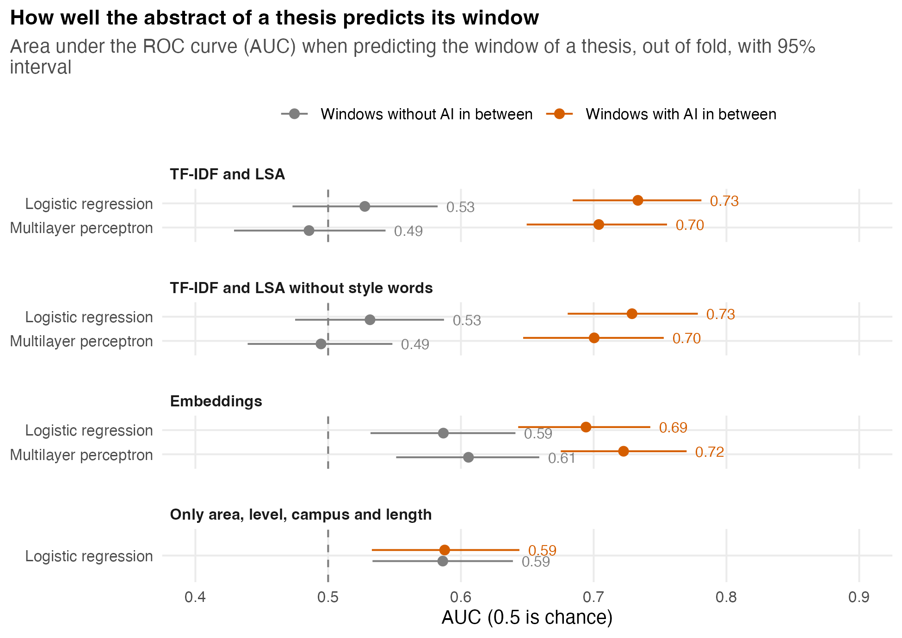
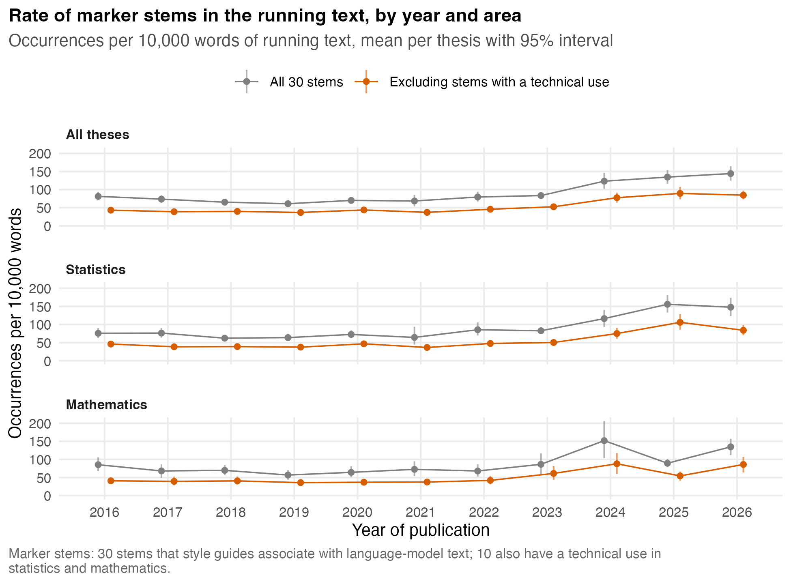
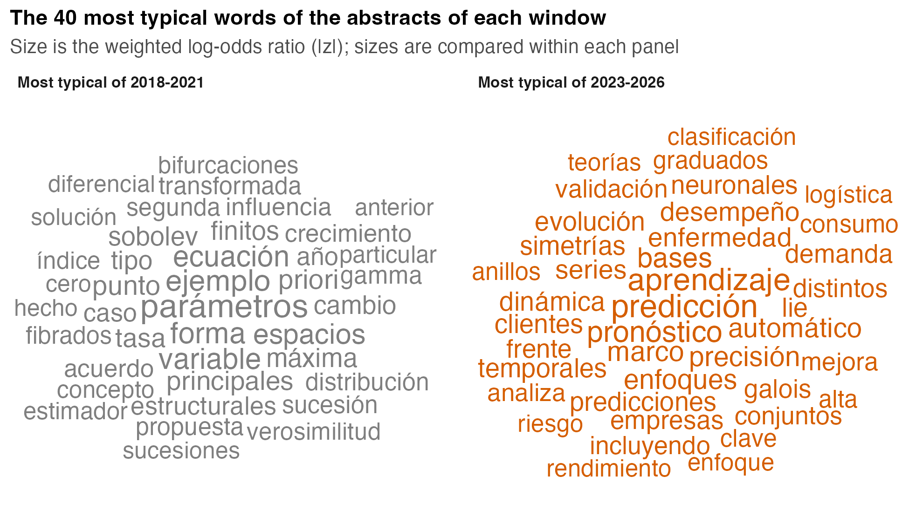

```{=typst}
#set par(justify: true, leading: 0.65em)
#set text(hyphenate: true)
#show heading: set text(fill: rgb("#1B365D"), weight: "bold")
#show table.cell: set par(justify: false)
#show table.cell: set text(size: 8pt)
#show figure.caption: set text(size: 8.5pt)
#set figure(placement: auto, scope: "parent")
#set columns(gutter: 0.7cm)
```

```{r}
#| label: preparar
IDIOMA <- "en"
source("codigo/cifras.R")
source("codigo/resumen.R")
abstract <- resumen()
# arXiv no acepta resúmenes de más de 1920 caracteres ni caracteres fuera de ASCII en sus metadatos.
stopifnot(nchar(abstract) <= 1920, !grepl("[^ -~]", abstract))
dir.create("arxiv", showWarnings = FALSE)
writeLines(abstract, "arxiv/abstract.txt")
```

```{=typst}
#place(top + center, scope: "parent", float: true)[
#set align(left)
```

```{=typst}
#block(fill: rgb("#F2F5F9"), inset: 11pt, radius: 3pt, width: 100%)[
```

**Abstract.** `r abstract`

```{=typst}
]
```

**Keywords:** `r PALABRAS_CLAVE`.

*This is an English translation of the original Spanish article.*

```{=typst}
#v(0.6em)
]
```

# Introduction

A corpus of theses can change in three ways: in its **topics**, in its **shape** and in its **vocabulary**. Topics change when students leave some and move to others. Shape changes when theses pack into groups, spread out or form closed chains, where one topic resembles another, that one a third and the third the first again. Vocabulary changes when the same things are written about with other words. A single measure confounds them.

For vocabulary there is evidence in the English-language scientific literature: since 2023 the frequency of certain style words (generic words that do not name a topic) rose abruptly, and that excess was used to estimate how much writing went through a language model [@kobak2025delving; @liang2025quantifying; @gray2024contamination]. For topics and shape there is little evidence, and almost none on theses in Spanish.

This work asks whether the topics, shape or vocabulary of Statistics and Mathematics theses at the Universidad Nacional de Colombia have changed since 2023, and uses one tool for each kind of change. Topics are examined with a self-organizing map [@kohonen1982self], a competitive neural network, and with a classifier that predicts from its content which window (a group of consecutive years) a thesis belongs to. Shape is measured with the mean distance between theses and with persistent homology [@edelsbrunner2002topological; @carlsson2009topology], which summarizes a point cloud by the groups and cycles that appear when its points are connected at different distances. Vocabulary is counted in the running text of the theses.

A change between 2018-2021 and 2023-2026 cannot by itself be attributed to AI: the topics of a graduate program always shift. That is why each comparison "with AI in between" has a control between two earlier windows, "without AI in between". Only what exceeds the control counts as a finding.

# Related work

| Line of work | Idea | Works | In this article |
|:----|:--------|:------|:------|
| Topics from word matrices | Each document is a frequency vector that is reduced or decomposed into topics | @deerwester1990indexing; @blei2003latent; @hall2008studying | TF-IDF with latent semantic analysis, as the first representation |
| Topics from transformer representations | A pretrained model gives the vector of each document, which is then clustered | @grootendorst2022bertopic; @angelov2020top2vec; @egger2022topic | multilingual-E5 vectors as the second representation |
| Self-organizing maps of science | A grid of units orders the documents by similarity | @kohonen2000self; @polanco2001using; @skupin2013visualizing | 8 × 8 map on both representations |
| Topological data analysis of text | Persistent homology on text representations or concept networks | @zhu2013persistent; @wagner2012computational; @salnikov2018cooccurrence; @tulchinskii2023intrinsic | Scale and homology of the cloud of theses and of words, with permutation tests |
| Excess vocabulary | Words whose frequency rises from 2023 on | @kobak2025delving; @liang2025quantifying | Rate per thesis in the running text, with control and checks |

: Lines of work and what this article uses. {#tbl-familias}

@tbl-familias summarizes the lines of work each tool comes from. The self-organizing map was used to order millions of documents [@kohonen2000self; @skupin2013visualizing]; today topic modeling is done mostly with transformer embeddings, transformers being the neural network architecture of current language models [@grootendorst2022bertopic; @egger2022topic]. Here the two are combined: the self-organizing map is trained on the classical representation and on a transformer one [@vaswani2017attention; @wang2024multilingual], and we report whether the result depends on which one is used. Persistent homology on text is a newer and less settled line [@zhu2013persistent; @salnikov2018cooccurrence]; for that reason this work also tests which kind of change each statistic detects.

# Data

The corpus is the same as in the companion article on detection: `r ent(cifras["tesis_de_analisis"])` master's and doctoral theses in Statistics and Mathematics from the institutional repository of the Universidad Nacional de Colombia. Theses of the Maestría en Enseñanza de las Ciencias (a master's in science teaching) are excluded. From each Spanish abstract we removed the English parts, the LaTeX commands and the note "(Texto tomado de la fuente)" (text taken from the source) that the repository has added since 2021. The area of each thesis comes from the program or the degree awarded and, if those are missing, from the department.

For the theses from 2016 onward that are not in English, the PDF was also downloaded and the running text extracted. The running text consists of the blocks of 40 or more words in which at least 85% of the tokens are words without digits or symbols and at least 30% are function words (articles, prepositions, conjunctions). The filter leaves out indexes, tables, formulas and references. Theses with at least 2,000 words of running text are included: `r ent(cifras["tesis_con_texto_corrido"])`, with a median of `r ent(cifras["mediana_palabras_texto_corrido"])` words. There is running text for `r pc(ventana(2016, 2026, "con_texto_corrido") / ventana(2016, 2026))` of the theses from 2016 to 2026. Theses written in English have none: there are `r filter(temas, ventana == "2014-2017")$en_ingles`, `r filter(temas, ventana == "2018-2021")$en_ingles` and `r filter(temas, ventana == "2023-2026")$en_ingles` in the three windows defined next.

The abstracts are compared in three four-year windows: 2014-2017 (`r ventana(2014, 2017)` theses), 2018-2021 (`r ventana(2018, 2021)`) and 2023-2026 (`r ventana(2023, 2026)`). The year 2022 is left out because language models reached mass use at the end of that year and there is no way to know which theses they reached; 2026 is incomplete. Running text exists from 2016, so its two earlier windows span three years (2016-2018 and 2019-2021); the recent one is the same, 2023-2026.

A thesis counts as machine learning if its title or abstract names, among others, "aprendizaje automático" (machine learning), "redes neuronales" (neural networks), "bosques aleatorios" (random forests) or "inteligencia artificial" (artificial intelligence); the full list is in the code.

# Method

## Representations of the theses

Each thesis is its title followed by its abstract. Two representations are used, that is, two ways of turning that text into a vector.

**TF-IDF and LSA.** We compute the TF-IDF weight (the frequency of a term in the thesis, discounted if the term appears in many theses) of the words and word pairs that appear in at least five theses and in no more than half, without stop words (articles, prepositions). The matrix is reduced to 50 dimensions with latent semantic analysis (LSA) [@deerwester1990indexing]. Those dimensions retain `r pc(lsa["varianza_retenida_lsa"])` of the variance. Each vector is scaled to unit norm, so the Euclidean distance between two theses is a function of the cosine between them.

**Embeddings.** An embedding is the vector a pretrained model assigns to a text, such that texts with similar content end up close. The text goes through multilingual-E5 [@wang2024multilingual], a transformer encoder, and the vectors of its tokens (the word pieces into which the model splits the text) are averaged. The 768-dimensional vector is reduced to 50 by principal components and scaled to unit norm.

## Self-organizing map

The map is a grid of $8 \times 8$ units, each with a weight vector $w_j$ in the space of the theses. It is trained thesis by thesis with Kohonen's rule [@kohonen1982self; @kohonen2001self]. For each thesis $x$ the closest unit wins, $c = \arg\min_j \lVert x - w_j \rVert$, and it and its neighbors move toward $x$:

$$
w_j \leftarrow w_j + \alpha(t)\, e^{-d(j, c)^2 / 2 r(t)^2}\, (x - w_j),
$$ {#eq-kohonen}

where $d(j, c)$ is the distance between the two units on the grid. The rate $\alpha$ decreases from 0.5 to 0.01 and the radius $r$ from 4 to 0.5, both geometrically, over 30 passes through the corpus. Quality is measured with two errors [@kiviluoto1996topology]. The quantization error is the mean distance from each thesis to its winning unit; between unit-norm vectors the maximum is 2. The topographic error is the proportion of theses whose two closest units are not adjacent, counting as adjacent the eight units that surround a unit.

A map depends on the order of the data and on the initial weights. We train `r SEMILLAS` maps with different seeds per representation and measure their agreement with the adjusted Rand index between the assignments of each pair of maps: it equals 1 if two maps group the theses the same way and is close to 0 if they agree no more than expected by chance.

**Test.** We count how many theses of each window fall in each unit. If the theses of one window were spread over the map like those of the previous one, this table of units by windows would be homogeneous. The statistic is its chi-squared. The null distribution is obtained by permuting the window labels of the theses 2,000 times within each area and campus of the university, so that a change in the mix of areas or campuses is not taken for a change in topics. The test is run for both comparisons and on all `r SEMILLAS` maps.

## Classification of the window

Another way of measuring a change in topics is to ask whether the window of a thesis can be predicted from its representation. We train a multilayer perceptron (one hidden layer of 8 or 16 neurons, with size and penalty chosen by internal validation) and a logistic regression, with five-fold cross-validation repeated three times. TF-IDF and LSA are fitted within each fold, with the training theses only. We report the AUC of the out-of-fold probability, averaged over the three repetitions: the probability that the classifier gives a higher score to a thesis from the recent window than to one from the earlier window, where 0.5 is chance. The interval comes from resampling theses and does not include the variation from retraining. Folds are not grouped by author; an author with two theses in different windows does not help separate them.

Four inputs are compared. The first is TF-IDF with LSA. The second is the same after removing the style words from the text, to separate topic from writing: 30 connectives (such as "por lo tanto", therefore) and the marker stems without technical use, defined in the vocabulary section. The third is the embeddings. The fourth is a composition baseline: only the area, the level, the campus and the length of the abstract. It says how much is predicted without reading the content.

## Shape of the cloud and persistent homology

Each thesis is a point and the set is a cloud; two theses are close if their content is similar. The simplest measure of the shape of that cloud is its scale: the mean distance between two theses. It falls when the theses become more alike.

Persistent homology describes what scale does not see. The idea is to grow a ball of the same radius around each point. With a small radius all points are isolated. As the radius grows, points whose balls touch join into groups, and the groups merge until only one remains. Sometimes the joined points form a ring with a hole in the middle: thesis A resembles B, B resembles C and so on until returning to A, with no thesis in between. The ring disappears when the radius is large enough to close the hole. Each group and each ring is born at one radius and dies at another, and the difference is its persistence: short-lived ones are usually read as noise and long-lived ones as structure of the cloud [@edelsbrunner2002topological; @zomorodian2005computing].

In formal terms, the groups are connected components (dimension 0) and the rings are cycles (dimension 1). Given a radius $\varepsilon$, the Vietoris-Rips complex connects by an edge every pair of points at distance at most $\varepsilon$ and fills in each triangle whose three edges already exist. Each component and each cycle leaves an interval $[b_i, d_i)$: it is born at radius $b_i$ and dies at $d_i$. The intervals of one dimension form its persistence diagram: there is a diagram of components and a diagram of cycles.

Each diagram is summarized by its total persistence,

$$
L_k = \sum_{i} (d_i - b_i), \qquad k = 0, 1,
$$ {#eq-persistencia}

not counting the component that never dies. $L_0$ is the length of the shortest network that connects all points (the minimum spanning tree): it measures the distance between neighboring theses, and it falls when each thesis has another very similar one. $L_1$ adds up the lifetimes of the cycles. Two different diagrams can have the same total persistence. That is why we also use the order-1 Wasserstein distance between the diagrams of two windows: it matches the intervals of one diagram with those of the other and adds up how much births and deaths must move for them to coincide; it is zero if the diagrams are equal. $W_0$ is the distance between the component diagrams and $W_1$ between the cycle diagrams. If a cloud contracts, its diagrams shrink even if its shape stays the same. To separate the two, $W_0$ and $W_1$ are also computed "scaled", after dividing each cloud by its mean distance.

Three clouds are studied per window: the theses with their LSA vector, the theses with their embedding, and the words, where each point is one of the 200 most frequent terms, described by its TF-IDF weight in each thesis of the subsample and reduced to 30 dimensions. Zhu [-@zhu2013persistent] and Wagner, Dłotko and Mrozek [-@wagner2012computational] proposed constructions of this kind for text.

Total persistence grows with the number of points, so all clouds are built from subsamples of 150 theses. To compare two windows, each statistic is the mean over ten pairs of subsamples, one from each window. Its null distribution is obtained by permuting the window labels of the theses 2,000 times within each area and campus and repeating the same computation; the permutation scheme follows Robinson and Turner [-@robinson2017hypothesis], with different statistics. There are seven statistics (the differences in mean distance, in $L_0$ and in $L_1$, and the distances $W_0$ and $W_1$, raw and scaled), three clouds and two comparisons: `r nrow(contrastes)` tests. The tests are two-sided for the differences and one-sided for the distances. The diagrams are computed with Ripser [@bauer2021ripser; @tralie2018ripser]. The p-values are adjusted with the method of Benjamini and Hochberg [-@benjamini1995controlling]; the adjusted value is called q.

**Two checks.** The test with AI in between is repeated without the machine learning theses, to see how much of the change in shape is due to that topic. Separately, we measure whether those theses are closer together than a random set of theses of the same size from their window, with 5,000 draws.

**Test with a known change.** To learn which kind of change each statistic detects, the 2018-2021 window is split at random into two halves, between which there is no real difference. In one half, 10%, 20% or 30% of the theses are replaced by machine learning theses from 2023-2026, and then the two halves are compared. This is repeated with `r unique(potencia$replicas)` partitions per fraction, with the LSA cloud, `r unique(potencia$tesis_por_nube)` theses per cloud, five pairs of subsamples and 99 permutations, and we count in how many partitions the test rejects at 5%.

## Vocabulary

For each thesis with running text we compute the rate of each word per 10,000 words. For each word, the rates of the theses of one window are compared with those of the other with the test of Mann and Whitney [-@mann1947test], which does not assume normality. We test the words present in at least 20% of the theses of the three windows together, so that both comparisons use the same set of words. We count the words with a Benjamini and Hochberg [-@benjamini1995controlling] q-value below 0.05. The unit is the thesis and not the word: a long thesis that repeats a term counts once.

A change in vocabulary can come from elsewhere: longer theses, another mix of areas or new topics. The count is repeated with four checks: with each thesis cut at random to 4,000 words, which leaves out those with fewer; only Statistics; only Mathematics; and without the machine learning theses.

Separately, we follow year by year the combined rate of `r nrow(raices_ia)` marker stems, the same as in the article on detection. The list was taken from Spanish-language style guides about language-model text, not from these data, and it has no academic source. Of them, `r sum(raices_ia$con_uso_tecnico)` also have a technical use ("robusto", "integral", "proporción": robust, integral, proportion), so the series is reported with and without them. For the abstracts we compute the log-odds ratio of Monroe, Colaresi and Quinn [-@monroe2008fightin], which says which words are more typical of one window than of another and gives less weight to rare words.

# Results

## Topics on the map

```{r}
#| label: tbl-mapas
#| tbl-cap: !expr 'paste0("Permutation test of how the theses are distributed on the self-organizing map, in ", SEMILLAS, " maps per representation. p: p-value of the chi-squared with 2,000 permutations.")'
kable(tabla_mapas())
```

With the LSA representation, the theses of 2023-2026 are distributed differently from those of 2018-2021 in `r sum(mapa("LSA", CON_IA)$valor_p < 0.05)` of the `r SEMILLAS` maps, with a median p-value of `r nm(median(mapa("LSA", CON_IA)$valor_p), 3)` (@tbl-mapas). In the control, 2014-2017 against 2018-2021, the test rejects in `r sum(mapa("LSA", SIN_IA)$valor_p < 0.05)` maps, with a median p of `r nm(median(mapa("LSA", SIN_IA)$valor_p), 3)`. With the embeddings it rejects in `r sum(mapa("incrustaciones", CON_IA)$valor_p < 0.05)` maps with AI in between and in `r sum(mapa("incrustaciones", SIN_IA)$valor_p < 0.05)` in the control: the result is weaker with that representation. The mean quantization error is `r nm(mean(mapa("LSA", CON_IA)$error_cuantizacion), 2)` with LSA and `r nm(mean(mapa("incrustaciones", CON_IA)$error_cuantizacion), 2)` with the embeddings, and the topographic error `r pc(mean(mapa("LSA", CON_IA)$error_topografico), 1)` and `r pc(mean(mapa("incrustaciones", CON_IA)$error_topografico), 1)`.

Maps from different seeds are not equal: the mean adjusted Rand index between pairs is `r nm(filter(estabilidad, representacion == "LSA")$rand_ajustado_medio)` with LSA and `r nm(filter(estabilidad, representacion == "incrustaciones")$rand_ajustado_medio)` with the embeddings. A topic does not fall in the same unit from one map to another, and that is why the conclusion rests on the repeated test and not on reading one map.

{#fig-mapa width=58%}

```{r}
#| label: tbl-unidades
#| tbl-cap: "Units of the map in the figure with more and with fewer theses of 2023-2026 than expected relative to 2018-2021. The year columns give the number of theses. Pearson residual against a homogeneous distribution: positive is excess and negative, deficit. The terms are in Spanish, as in the abstracts. It is an illustration: in another map the units are different."
kable(tabla_unidades())
```

@fig-mapa and @tbl-unidades illustrate where the change happens in one of the maps. The unit with the largest excess of recent theses (A) gathers the terms "`r filter(destacadas, letra == "A")$terminos`". Since in another map the units are different, we use a measure that does not depend on the map: the machine learning theses. They are `r filter(temas, ventana == "2014-2017")$de_aprendizaje_automatico` of `r filter(temas, ventana == "2014-2017")$tesis` in 2014-2017 (`r pc(ml("2014-2017"))`), `r filter(temas, ventana == "2018-2021")$de_aprendizaje_automatico` of `r filter(temas, ventana == "2018-2021")$tesis` in 2018-2021 (`r pc(ml("2018-2021"))`) and `r filter(temas, ventana == "2023-2026")$de_aprendizaje_automatico` of `r filter(temas, ventana == "2023-2026")$tesis` in 2023-2026 (`r pc(ml("2023-2026"))`).

## Classification of the window

{#fig-clasificacion width=74%}

With TF-IDF and LSA fitted within the fold, the perceptron separates 2023-2026 from 2018-2021 with an AUC of `r auc_ic(CON_IA)`; in the control the AUC is `r auc_ic(SIN_IA)` (@fig-clasificacion). The difference between the two comparisons is `r nm(auc("diferencia"))` (95% interval: `r nm(auc("diferencia", columna = "auc_inf"))` to `r nm(auc("diferencia", columna = "auc_sup"))`). With logistic regression the AUCs are `r nm(auc(CON_IA, clas = "logistica"))` and `r nm(auc(SIN_IA, clas = "logistica"))`.

Without the style words, the AUC of the perceptron with AI in between is `r nm(auc(CON_IA, "sin palabras de estilo"))`, against `r nm(auc(CON_IA))` with all words: removing style does not lower it, so in the abstracts what separates the recent theses is topic. With the embeddings it is `r nm(auc(CON_IA, "incrustaciones"))`, and `r nm(auc(SIN_IA, "incrustaciones"))` in the control. The composition baseline, which does not read the content, reaches `r nm(auc(CON_IA, "composición", "logistica"))` with AI in between and `r nm(auc(SIN_IA, "composición", "logistica"))` in the control. Part of what separates two windows is that the area, the campus and the length of the abstracts change, and that happens in both comparisons.

## The shape of the cloud of theses

![Position of each observed statistic in its null distribution, by cloud. The gray band runs from the 2.5th to the 97.5th percentile of what shuffling the theses between windows gives. Orange dot: with AI in between. Gray dot: control. $L_0$ and $L_1$ are the total persistence of components and of cycles; $W_0$ and $W_1$, the distances between diagrams. For the distances the test is one-sided: only falling out on the right counts, and the 5% threshold is the 95th percentile, slightly before the edge of the band.](figuras/en/fig_homologia.png){#fig-homologia width=88%}

```{r}
#| label: tbl-forma
#| tbl-cap: "Shape tests on the cloud of theses, with both representations (LSA and embeddings, E5): permutation p-value and, in parentheses, q-value after the multiplicity adjustment. \"With AI\": 2018-2021 against 2023-2026. \"Control\": 2014-2017 against 2018-2021."
kable(tabla_forma())
```

The cloud of theses contracted (@fig-homologia and @tbl-forma). Between 2018-2021 and 2023-2026 the mean distance between two theses fell by `r pc(-contraccion(LSA), 1)` with LSA and `r pc(-contraccion(E5), 1)` with the embeddings, and both drops keep a q below 0.05. In the control the mean distance changes by `r pc(contraccion(LSA, SIN_IA), 1)` with LSA (p = `r nm(p_de(LSA, SIN_IA, ESCALA), 3)`, q = `r nm(p_de(LSA, SIN_IA, ESCALA, "valor_q"), 3)`) and `r pc(contraccion(E5, SIN_IA), 1)` with the embeddings (p = `r nm(p_de(E5, SIN_IA, ESCALA), 2)`). The recent theses are more alike than those of the previous window.

Of the `r nrow(contrastes)` tests, `r sum(contrastes$valor_p < 0.05)` have a p-value below 0.05: `r sum(filter(contrastes, comparacion == CON_IA)$valor_p < 0.05)` with AI in between and `r sum(filter(contrastes, comparacion == SIN_IA)$valor_p < 0.05)` in the control. After the multiplicity adjustment `r nrow(sobreviven)` remain, all with AI in between and in the clouds of theses: with LSA, `r que_sobreviven(LSA)`; with the embeddings, `r que_sobreviven(E5)`. In the control the smallest q is `r nm(min(filter(contrastes, comparacion == SIN_IA)$valor_q), 3)`. In the cloud of words no test survives; the smallest p-value with AI in between is `r nm(min(filter(contrastes, nube == "palabras", comparacion == CON_IA)$valor_p), 3)`.

The cycles of the cloud also differ: $W_1$ survives the adjustment with both representations. Part of that difference is the contraction itself, because a smaller cloud has smaller cycles. Scaled $W_1$, which discounts the contraction, gives p = `r nm(p_de(LSA, CON_IA, "W1 a escala"), 3)` with LSA (q = `r nm(p_de(LSA, CON_IA, "W1 a escala", "valor_q"), 3)`) and p = `r nm(p_de(E5, CON_IA, "W1 a escala"), 3)` with the embeddings (q = `r nm(p_de(E5, CON_IA, "W1 a escala", "valor_q"), 3)`). In the control that statistic gives p = `r nm(p_de(LSA, SIN_IA, "W1 a escala"), 2)` with LSA and `r nm(p_de(E5, SIN_IA, "W1 a escala"), 3)` with the embeddings. The evidence of a change in the cycles is therefore weak: with LSA it does not survive the adjustment, and with the embeddings the control gives a similar p-value. What exceeds the control with both representations is the contraction, by a wider margin with the embeddings: with LSA the control also contracts somewhat, as seen above.

For $L_0$ no change is detected with LSA (p = `r nm(p_de(LSA, CON_IA, "diferencia de L0"), 2)`), and with the embeddings it gives p = `r nm(p_de(E5, CON_IA, "diferencia de L0"), 3)`, which does not survive the adjustment: the distance between neighboring theses shows no clear change. $L_1$ is lower in 2023-2026 than in 2018-2021 with the embeddings (p = `r nm(p_de(E5, CON_IA, "diferencia de L1"), 3)`, q = `r nm(p_de(E5, CON_IA, "diferencia de L1", "valor_q"), 3)`); since $L_1$ was not computed scaled, that drop may also be the contraction.

The machine learning theses explain part of the contraction. They are closer together than a random set of theses from their window: their mean distance is `r nm(filter(compacidad, nube == LSA)$distancia_media)` against `r nm(filter(compacidad, nube == LSA)$distancia_media_al_azar)` with LSA and `r nm(filter(compacidad, nube == E5)$distancia_media)` against `r nm(filter(compacidad, nube == E5)$distancia_media_al_azar)` with the embeddings (p = `r nm(max(compacidad$valor_p), 4)` in both cases). Without them the contraction remains, smaller: `r pc(-contraccion(LSA, SIN_APRENDIZAJE, sin_aprendizaje), 1)` with LSA (p = `r nm(p_de(LSA, SIN_APRENDIZAJE, ESCALA, tabla = sin_aprendizaje), 3)`) and `r pc(-contraccion(E5, SIN_APRENDIZAJE, sin_aprendizaje), 1)` with the embeddings (p = `r nm(p_de(E5, SIN_APRENDIZAJE, ESCALA, tabla = sin_aprendizaje), 4)`). $W_1$ holds with LSA (p = `r nm(p_de(LSA, SIN_APRENDIZAJE, "W1", tabla = sin_aprendizaje), 4)`) and not with the embeddings (p = `r nm(p_de(E5, SIN_APRENDIZAJE, "W1", tabla = sin_aprendizaje), 2)`).

```{r}
#| label: tbl-plantado
#| tbl-cap: "Test with a known change. Each cell says in how many partitions the statistic rejects at 5% when that fraction of one half of the 2018-2021 window is replaced by machine learning theses from 2023-2026."
kable(tabla_plantado())
```

The test with a known change says how much these statistics see (@tbl-plantado). With no planted change, none rejects in more than `r max(filter(potencia, fraccion_plantada == 0)$rechazos)` of the `r unique(potencia$replicas)` partitions, as expected at a 5% level. With 10% of machine learning theses planted, the one that rejects most does so in `r max(filter(potencia, fraccion_plantada == 0.1)$rechazos)` partitions; with 20%, in `r max(filter(potencia, fraccion_plantada == 0.2)$rechazos)`; with 30%, in `r max(filter(potencia, fraccion_plantada == 0.3)$rechazos)`. Those theses are `r pc(ml("2023-2026"))` of the recent window. The test uses smaller clouds than the real comparison and half the pairs, so it probably underestimates the power of the real comparison. Even so, it shows that a change of topic of that size is close to the limit of what these statistics detect. A test that does not reject, like those on the cloud of words, does not prove that there is no change.

```{=typst}
#place.flush()
```

## The vocabulary of the running text

```{r}
#| label: tbl-vocabulario
#| tbl-cap: "Words whose rate changes between two windows (q-value below 0.05), from the same set of words, with all theses and with four checks. In parentheses, theses in each window."
kable(tabla_vocabulario())
```

Of the `r ent(voc(CON_IA)$palabras_probadas)` words tested, `r voc(CON_IA)$suben` rise and `r voc(CON_IA)$bajan` fall between 2019-2021 and 2023-2026. In the control `r ifelse(voc(SIN_IA)$suben + voc(SIN_IA)$bajan == 0, "none has", paste(voc(SIN_IA)$suben + voc(SIN_IA)$bajan, "have"))` a q below 0.05, although `r pc(voc(SIN_IA)$p_menor_que_005)` have an unadjusted p-value below 0.05, against `r pc(voc(CON_IA)$p_menor_que_005)` with AI in between (@tbl-vocabulario).

The result shrinks under the checks but does not disappear. With all theses cut to the same length, `r voc(CON_IA, "longitud fija")$suben` rise. Without the machine learning theses, `r voc(CON_IA, "sin aprendizaje automático")$suben` rise. In Statistics `r voc(CON_IA, "Estadística")$suben` rise and in Mathematics `r voc(CON_IA, "Matemáticas")$suben`, with `r voc(CON_IA, "Matemáticas")$n_tesis_a` and `r voc(CON_IA, "Matemáticas")$n_tesis_b` theses: with so few, the test has little power.

{#fig-palabras width=70%}

The words that rise most mix style and topic (@fig-palabras). Of the 15 with the largest statistic, `r sum(suben_mas$es_marcadora)` start with a marker stem. The first eight are `r entre(head(suben_mas$palabra, 8))`. Several are generic and equivalent to those found in excess in English biomedical abstracts [@kobak2025delving]; others may also come from the rise in machine learning theses. Those that fall most are function words and turns of Spanish mathematical prose: `r entre(head(bajan_mas$palabra, 8))`.

{#fig-marcadores width=74%}

The marker stems, a list fixed in advance, give the same result (@fig-marcadores). Without the stems with a technical use, their combined rate was `r nm(tasa_media(2016, 2021, "sin uso técnico"), 0)` per 10,000 words between 2016 and 2021, `r nm(tasa_media(2022, 2023, "sin uso técnico"), 0)` in 2022 and 2023, and `r nm(tasa_media(2024, 2026, "sin uso técnico"), 0)` between 2024 and 2026. Between those same periods, from 2016-2021 to 2024-2026, it goes from `r nm(tasa_media(2016, 2021, "sin uso técnico", "Estadística"), 0)` to `r nm(tasa_media(2024, 2026, "sin uso técnico", "Estadística"), 0)` in Statistics, from `r nm(tasa_media(2016, 2021, "sin uso técnico", "Matemáticas"), 0)` to `r nm(tasa_media(2024, 2026, "sin uso técnico", "Matemáticas"), 0)` in Mathematics and from `r nm(tasa_media(2016, 2021, "sin uso técnico", "sin aprendizaje automático"), 0)` to `r nm(tasa_media(2024, 2026, "sin uso técnico", "sin aprendizaje automático"), 0)` without the machine learning theses. Of the `r nrow(raices_ia)` stems, `r sum(raices_ia$valor_q < 0.05 & raices_ia$z > 0)` rise with q below 0.05 with AI in between, `r sum(raices_ia$valor_q < 0.05 & raices_ia$z > 0 & !raices_ia$con_uso_tecnico)` of them without technical use, and in the control `r cuantas_cambian(sum(raices_previas$valor_q < 0.05))`.

{#fig-nube width=80%}

In the abstracts, the words most typical of each window are almost all about topic (@fig-nube): those of 2023-2026 are `r mas_propias("2023-2026")` and those of 2018-2021, `r mas_propias("2018-2021")`.

```{=typst}
#place.flush()
```

# Discussion and limitations

Topics moved toward machine learning more than they moved before, although part of the difference between windows is corpus composition and the control also rejects in some maps. The cloud of theses contracted: recent theses are more alike, with both representations and more than in the control. The cycles of the cloud also differ, but once the contraction is discounted that evidence is weak. Since 2024 the running text uses the marker stems `r nm(tasa_media(2024, 2026, "sin uso técnico") / tasa_media(2016, 2021, "sin uso técnico"), 1)` times as often as from 2016 to 2021.

The shift in topics does not need AI as a writing tool: more students writing theses on machine learning is a change in the research agenda. The contraction has three explanations that these data do not separate. One is that the theses concentrate on fewer topics; it is supported by the machine learning theses being closer together than a random set, although without them the contraction remains. Another is that the abstracts are written more alike. The third is that recent abstracts are longer, and two long texts share more vocabulary than two short ones. Telling them apart would require repeating the measure without the style words and between abstracts of similar length; those checks are not in this analysis. The change in vocabulary is compatible with assisted writing, because its timing and the kind of words match what was observed in the English-language literature [@kobak2025delving], but it does not prove it. The companion article on detection estimates, with another method, that the proportion of abstracts with AI style rises in 2025 and 2026.

Limitations:

1. **Temporal association.** Nothing here isolates the cause. Between 2021 and 2023 the faculty, the research lines or the programs offered may also have changed; none of these was measured.
2. **One university and one repository.** Only the theses that were deposited are included, and the cataloging changed over the years. Three cataloging artifacts were corrected, described in the article on detection; there may be others.
3. **The windows were chosen.** They span four years in the abstracts and three and four in the running text, and 2026 is incomplete. Other windows may give other figures.
4. **The abstract is not the thesis.** The map, the classifier and the homology use titles and abstracts, with a median of `r cifras["mediana_palabras_resumen"]` words per thesis: with so little text, fine-grained topics may not show.
5. **The running text is a filtered sample.** The filter leaves out more text in theses with many formulas, and theses written in English do not enter. The check by area shows the rise in both, with little power in Mathematics.
6. **The shape statistics were chosen along the way.** Two representations, seven statistics and subsamples of 150 theses were used. The statistics were expanded during the review of the work: the first version only tested $L_0$ and $L_1$, which did not reject, and the mean distance and the Wasserstein distances were added afterwards. The multiplicity adjustment covers the `r nrow(contrastes)` final tests, not that choice. The test with a known change uses smaller clouds than the real comparison. We do not report how much the results change with another dimension of the representations or another subsample size.
7. **Single words.** The vocabulary analysis does not disambiguate: "marco" counts the same in "marco teórico" (theoretical framework) and as a surname.
8. **The contrast between comparisons is informal.** That a result "exceeds the control" is read from the two p-values or the two intervals; only for the classifier is an interval given for the difference.

```{=typst}
#place.flush()
```

# Conclusions

Since 2023, Statistics and Mathematics theses at the Universidad Nacional de Colombia have changed in topics and vocabulary, and their cloud has contracted: recent theses are more alike. The self-organizing map and the perceptron show a shift in topics larger than the one between the earlier windows; on the map, in `r sum(mapa("LSA", CON_IA)$valor_p < 0.05)` of `r SEMILLAS` seeds with LSA and in `r sum(mapa("incrustaciones", CON_IA)$valor_p < 0.05)` with the embeddings. Persistent homology finds that the cycles of the cloud differ, but once the contraction is discounted that evidence is weak. Since 2024 the running text shows a rise in marker stems that does not occur between the earlier windows; the number of words that rise falls when length is fixed, areas are separated and machine learning theses are removed, but it does not disappear. Everything is temporal association: the effect of AI is not isolated.

# Data and code availability {.unnumbered}

The metadata and the abstracts are public in the institutional repository of the Universidad Nacional de Colombia. The code that downloads them, the aggregated results and the code of all analyses and figures are at <https://github.com/danielvillarengifo/topologia-temas-tesis-unal>.
